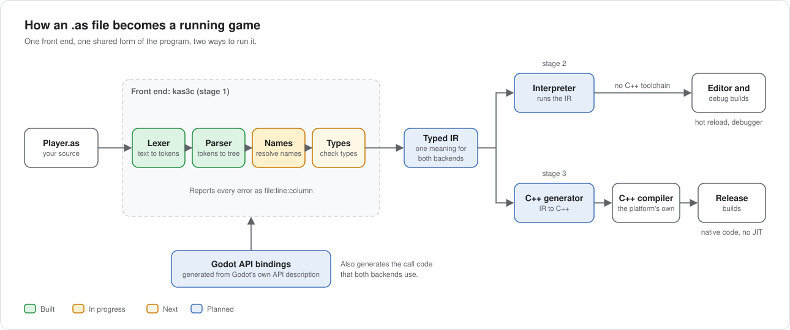

<p align="center">
  <picture>
    <source media="(prefers-color-scheme: dark)" srcset="editors/jetbrains/src/main/resources/META-INF/pluginIcon_dark.svg">
    
  </picture>
</p>

# Kumikae AS3

ActionScript 3 as a first-class scripting language for Godot 4, by [AniCanon](https://github.com/AniCanon).

You write AS3 classes that extend Godot's own classes and attach them to nodes, as you do with GDScript or
C#. While you work, an interpreter runs your scripts and reloads them when you save. For speed, the same
scripts compile to native code through C++.

> **Status: alpha.** Scripts run in Godot 4.7 on macOS and in the iOS Simulator, with hot reload and editor
> support in Rider and VS Code. Native code matches or beats Godot C# on the project's frame benchmarks, and
> Godot builds it when you press Play on macOS or export for iOS. Android ARM64 runs on an emulator through
> Rider. There is no debugger yet. Windows and Linux are untested. See the [roadmap](docs/roadmap.md).

## What a script looks like

```actionscript
package game {
    import godot.*;

    public class Player extends CharacterBody2D {
        [Export] public var speed:Number = 300;
        [Export] public var jumpSpeed:Number = 400;
        [Signal] public var died:Signal;

        override public function _ready():void {
            (getNode("Hitbox") as Area2D).bodyEntered.add(onBodyEntered);
        }

        override public function _physicsProcess(delta:Number):void {
            velocity.x = Input.getAxis("left", "right") * speed;
            if (isOnFloor() && Input.isActionJustPressed("jump")) {
                velocity.y = -jumpSpeed;
            }
            moveAndSlide();
        }

        private function onBodyEntered(body:Node2D):void {
            if (body.isInGroup("enemies")) {
                died.emit();
                queueFree();
            }
        }
    }
}
```

- **The class extends a Godot class.** Attach the script to a `CharacterBody2D` node and Godot calls
  `_ready` and `_physicsProcess`.
- **`[Export]` shows a field in the inspector,** and `[Signal]` declares a signal other scripts can listen
  to. Both are ordinary AS3 metadata tags.
- **Godot's API reads as AS3.** Methods are lowerCamel (`moveAndSlide`), Godot's properties are AS3
  properties (`velocity`), and a signal is a property you add a listener to (`bodyEntered.add`).
- **`velocity.x = ...` changes the body's velocity.** The compiler writes the changed vector back.
- **Mistakes are compile errors.** A misspelled method or a wrong argument type is reported with its file,
  line and column before the game runs.

## What you get

| | |
|---|---|
| **The whole Godot API, typed** | All 1,036 Godot classes are available under AS3 names and checked at compile time, including arithmetic on `Vector2` and the other math types. |
| **The AS3 language** | Classes, interfaces, closures, `Array`, `Vector.<T>`, `Dictionary`, `try`/`catch`, `RegExp`, `Date`, `JSON`, and AS3's runtime errors with stack traces. |
| **Hot reload** | Save a script while the game runs and the game takes the new code and keeps its state. On desktop and in the iOS Simulator. [How it works](docs/hot-reload.md). |
| **Native speed** | The same scripts compile to native code, level with or ahead of Godot C# on every frame benchmark the project runs. [The numbers and the techniques](docs/performance.md). |
| **Editor support** | Errors as you type, completion, navigation and hover through a language server. A [Rider plugin](editors/jetbrains/README.md) adds run configurations, a test runner, settings and scene editors, and embedded iOS and Android device panels; a [VS Code client](editors/vscode/README.md) covers editing. |
| **Tests in AS3** | A small [testing library](testing/README.md) with results shown in Rider. |

## Get started

You need macOS, CMake 3.22 or later, a C++17 compiler, and Python 3 for the tests.

1. Build the compiler and run its tests:

   ```bash
   cmake -S compiler -B compiler/build
   cmake --build compiler/build -j
   ctest --test-dir compiler/build --output-on-failure
   ```

2. Check a script against Godot's API:

   ```bash
   compiler/build/kas3c check compiler/tests/corpus/RayQueries.as
   ```

   Errors go to standard error as `<file>:<line>:<column>: error: <message>`.

3. Run a program on the command line:

   ```bash
   compiler/build/kas3c run compiler/tests/run/classes.as
   ```

To run scripts inside Godot, build the Godot extension and open the example game. The steps are in
[examples/coin-dash](examples/coin-dash/README.md). To set up an editor, see [editors](editors/README.md).

To write your own scripts, read [Using AS3 in Godot](docs/godot.md) and
[The AS3 language](docs/language.md).

## How it works



1. **The front end** reads your `.as` files, resolves names and checks types against Godot's API.
2. **The typed IR** (intermediate representation) is the single definition of what your program means.
3. **The interpreter** runs the IR directly. You need no C++ toolchain while you work, and you get hot
   reload.
4. **The C++ backend** writes the IR as C++, and the platform's own compiler turns that into native code.
   There is no just-in-time compiler, because iOS and consoles forbid one.

Both ways of running a program must behave identically: one suite of AS3 programs runs on both, and a
difference is a failing test. Read more in [How it works](docs/how-it-works.md).

## Progress

| Area | State |
|---|---|
| Compiler front end: parser, names, types, Godot's API | Built |
| Language server: errors, completion, navigation, hover | Built |
| Interpreter in Godot: the AS3 language, `[Export]`, `[Signal]`, hot reload | Built |
| Native code through C++ | Built; level with or ahead of C# on the frame benchmarks |
| Native code when you press Play | Built; on by default on macOS |
| iOS | Native AS3 runs in the Simulator. ARM64 device builds link successfully. [iOS export and signing](docs/godot.md#ios) |
| Rider plugin and VS Code client | Built; no debugger yet |
| Debugger | Planned |
| Android ARM64 | Interpreter runs on an emulator through Rider |
| Windows, Linux | Planned |
| Consoles | Planned, in a separate repository |

The [roadmap](docs/roadmap.md) has the detail and the known limits.

## Repository layout

| Path | Contents |
|---|---|
| [`compiler/`](compiler/README.md) | The compiler, the interpreter, the C++ backend, the Godot extension and the language server, with their tests. |
| [`editors/`](editors/README.md) | The Rider plugin and the VS Code client. |
| [`testing/`](testing/README.md) | The AS3 testing library and its runner. |
| [`examples/`](examples/coin-dash/README.md) | A small game written in AS3. |
| [`docs/`](docs/README.md) | The language, using AS3 in Godot, how it works, performance, hot reload and the roadmap. |

To change the code, start with [CONTRIBUTING.md](CONTRIBUTING.md).

## License and credits

AniCanon licenses Kumikae AS3 under the [MIT License](LICENSE). You can ship a commercial game and
keep its source private. When you distribute the Kumikae runtime with your game, include a copy of
the license and its copyright notice.

The JetBrains plugin’s light and dark AS3 file icons are adapted from the
[ActionScript icon in vscode-icons](https://github.com/vscode-icons/vscode-icons/blob/master/icons/file_type_actionscript.svg)
by Roberto Huertas and the vscode-icons contributors. Both variants use
[CC BY-SA 4.0](https://creativecommons.org/licenses/by-sa/4.0/). The
[icon notice](editors/jetbrains/src/main/resources/icons/NOTICE.md) describes the changes.

The generated Godot API declarations carry [Godot’s MIT notice](compiler/godot/NOTICE.md).
