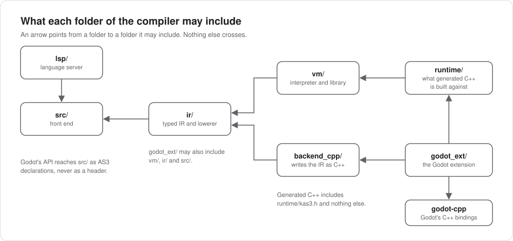

# The compiler

This folder holds everything that turns ActionScript 3 source into a running program: the compiler front
end, the typed IR, the interpreter, the C++ backend, the Godot extension, and the language server, with
their tests.

This page is for someone building or changing that code. If you write AS3, read
[The AS3 language](../docs/language.md) and [Using AS3 in Godot](../docs/godot.md) instead. For the design
as a whole, read [How it works](../docs/how-it-works.md).

## What is in each folder

| Folder | Holds |
|---|---|
| [`src/`](src/README.md) | The front end: lexer, parser, name resolution, type checking, and the queries an editor asks |
| [`ir/`](ir/README.md) | The typed IR, and the lowerer that produces it from the checked syntax tree |
| [`vm/`](vm/README.md) | The interpreter, the AS3 standard library, and the interfaces through which it reaches an engine |
| [`backend_cpp/`](backend_cpp/README.md) | The C++ backend: the IR written as C++ source |
| [`runtime/`](runtime/README.md) | The headers generated C++ is built against, and the host that runs a compiled program |
| [`godot_ext/`](godot_ext/README.md) | The Godot extension: AS3 as a Godot scripting language |
| [`lsp/`](lsp/README.md) | The language server |
| [`godot/`](godot/README.md) | The generator that writes Godot's API as AS3 declarations |
| `builtins/` | AS3's own library (`Object`, `String`, `Error`, `flash.utils.Dictionary`) as declaration files |
| [`tools/`](tools/README.md) | The `kas3c` command line, the style check, and the generators the build runs |
| [`tests/`](tests/README.md) | The tests and the benchmarks |

The C++ follows the [C++ guidelines](../docs/cpp-guidelines.md). `tools/check_style.py` enforces the size
limits and runs with the tests.

## Layers



Each folder may include only what the diagram shows. The rule is what keeps the two ways of running a
program in agreement, and what lets the same front end run in the command line, the language server and
Godot.

- **`src/` includes nothing else.** Godot's API reaches it as AS3 declarations, like any source file.
- **`ir/` includes `src/`.** It names Godot's methods and properties through a generated name table, never
  through a Godot header.
- **`vm/` includes `ir/`.** It knows an engine only through the four interfaces in `vm/host.h`.
- **`backend_cpp/` includes `ir/`.** It writes C++ as text.
- **`runtime/` includes `vm/` and `ir/`.** Generated C++ includes `runtime/kas3.h` and nothing else.
- **`lsp/` includes `src/`.** The language server is the front end, not a second compiler.
- **`godot_ext/` is the only folder that includes godot-cpp.**

If a change needs an include that crosses these lines, add an entry to the interface the lower layer owns.

The build has one static library for each layer: `kas3front`, `kas3ir`, `kas3vm`, `kas3backend_cpp`,
`kas3runtime` and `kas3lsp`. All are built without exceptions or RTTI. The extension, `kas3_godot`, is the
only shared library, and the only target built with RTTI, because godot-cpp needs it.

## Build and test

You need CMake 3.22 or later, a C++17 compiler, and Python 3.

```sh
cmake -S compiler -B compiler/build
cmake --build compiler/build -j
ctest --test-dir compiler/build --output-on-failure
```

To build the Godot extension as well, give CMake a
[godot-cpp](https://github.com/godotengine/godot-cpp) checkout for Godot 4.7. godot-cpp isn't part of this
repository.

```sh
cmake -S compiler -B compiler/build-godot -DKAS3_GODOT_CPP=<path to godot-cpp>
cmake --build compiler/build-godot --target kas3_godot
python3 compiler/tests/run_godot.py compiler/tests compiler/build/kas3c
```

The extension library is written to `tests/godot_project/bin`, beside the project that tests it. The last
command runs that project in headless Godot 4.7 and needs `godot` on the `PATH`, or its path in
`KAS3_GODOT`.

Before a merge, run the suite under the address and undefined-behavior sanitizers:

```sh
cmake -S compiler -B compiler/build-san -DKAS3_SANITIZE=ON -DCMAKE_BUILD_TYPE=Debug
cmake --build compiler/build-san -j && ctest --test-dir compiler/build-san --output-on-failure
```

[tests/README.md](tests/README.md) describes each test suite, how to add a test, and the benchmarks.

## The `kas3c` command line

`kas3c` is the front end, the interpreter, the C++ backend and the language server in one program.

| Command | What it does |
|---|---|
| `kas3c parse <file>...` | Reports syntax errors. `--dump-ast` also prints each file's syntax tree. |
| `kas3c check <file>...` | Reads the files as one program and reports every error. |
| `kas3c run <file>...` | Checks the program and runs it on the interpreter. |
| `kas3c ir <file>...` | Prints the typed IR the interpreter runs. |
| `kas3c pack [--godot] <file>... -o <file.kas3>` | Writes a precompiled binary IR module. With `--godot`, scripts under a Godot project retain their `res://` paths so scenes can attach them. |
| `kas3c cpp <file>... -o <folder>` | Writes the program as C++ source. |
| `kas3c lsp` | Serves an editor with the Language Server Protocol, over standard input and output. |

Errors go to standard error as `<file>:<line>:<column>: error: <message>`. The exit status is 0 for no
errors, 1 if errors were found, and 2 for bad usage or a file that can't be read.

### Options

| Option | Commands | What it does |
|---|---|---|
| `--no-godot` | `check`, `lsp` | Doesn't load Godot's API. Without this option `import godot.*` works with no setup, because the API is built into `kas3c`. |
| `--declarations <file>` | `check`, `lsp` | Loads a [declaration file](../docs/language.md#declaration-files). You can repeat it. |
| `--dump-names` | `check` | Prints what every name refers to, one line each: `<line>:<col> <name> -> <kind> <qualified name> <where>`. |
| `--dump-types` | `check` | Prints the type of each expression statement and initializer as `<line>:<col> <type>`. A type the compiler couldn't work out is `?`. |
| `--godot` | `ir`, `cpp` | Treats the files as scripts for Godot: loads Godot's API and expects no class to start the program. |
| `--unit` | `cpp` | Writes the whole program into `program.cpp`. |
| `--remember` | `cpp` | Makes each constructor tell the host what its object was built with, so that hot reload can update objects created as native code. For a game that is being edited. Without it, the C++ is the same to the byte. |
| `--stdio` | `lsp` | Accepted and ignored. Some editors add it. |

### Run a program

`kas3c run` constructs the class in the first file, as Flash constructs a document class. What the program
traces goes to standard output.

```sh
compiler/build/kas3c run compiler/tests/run/classes.as
```

An error that nothing catches goes to standard error with an AS3 stack trace, and the exit status is 1.
`kas3c run` has no engine, so a program that imports the `godot` package doesn't run there.

| Variable | Effect on `kas3c run` |
|---|---|
| `KAS3_TIME_LIMIT_MS` | The time after which a run is stopped with Error #1502. The default is 15 seconds, as in Flash. `0` means no limit. A program built as a plain executable reads it too. |
| `KAS3_NOW` | Fixes the time `Date` reads, in milliseconds since 1970, so that a test prints the same text every run. `TZ` sets the time zone. |
| `KAS3_REPORT_LEAKS` | Reports objects and strings still alive when the program ends, and exits with status 3. The test suite sets it. |
| `KAS3_REMEMBER_CONSTRUCTIONS` | Turns on the record hot reload keeps of constructor arguments, to measure its cost. A program built as a plain executable reads it too, and keeps the record if it was written with `--remember`. |
| `KAS3_STACK_KB` | The stack size of the thread a program runs on, in kilobytes. The default is 512 MB, so that the call-depth limit ends a runaway recursion before the stack does. |

### Write a program as C++

```sh
compiler/build/kas3c cpp compiler/tests/run/classes.as -o out/
```

`kas3c cpp` writes one `.cpp` file for each class, `program.h`, and `program.cpp`. With `--unit` it writes
`program.cpp` alone, which is what a release build uses: the C++ compiler then sees every function at once.
Both forms give the same program, and the tests build each.

If a program uses something the backend can't translate exactly, `kas3c` prints
`kas3c: not yet supported: <what>`, exits with status 1, and writes nothing.

Build the C++ against `runtime/` with these flags:

```sh
c++ -std=c++17 -O2 -fno-exceptions -fno-rtti -ffp-contract=off -fno-unroll-loops ...
```

There are two things to build it into:

- **A plain executable.** Link the C++ with `libkas3standalone.a`, `libkas3runtime.a` and the interpreter's
  libraries. The executable prints what `kas3c run` prints and exits with the same status. The `native`
  test group builds every program in `tests/run/` this way and compares the two.
- **A program library for Godot.** With `--godot`, the C++ is a project's scripts. Built as a shared
  library, it's what the extension loads in place of the interpreter. See
  [godot_ext/README.md](godot_ext/README.md#the-program-library).

[backend_cpp/README.md](backend_cpp/README.md) describes the generated code, and
[runtime/README.md](runtime/README.md) what it runs on.

## Where a new thing goes

| New thing | Where it goes |
|---|---|
| A syntax form | `src/parser_*.cpp` by kind, its node in `src/ast.h`, its case in `ast_walk.h` and `ast_printer.cpp`, and a golden file |
| A type rule or an error message | `src/typer_*.cpp` by what is typed. Write the message once, with `quoted()` for names |
| A rule the checker and the lowerer must agree on | A header in `src/` that both read, such as `whole_numbers.h` |
| An IR operation | One line in the table in `ir/ir_ops.h`, its case in `vm/interpreter_run.cpp`, and its lowering in the `ir/lower_*.cpp` that owns that kind of code |
| An operation in native code | `backend_cpp/patterns.h` if it's one C++ statement, otherwise the `function_*.cpp` that owns that kind. Until then it runs through the interpreter's library |
| Something asked of Godot | An entry on `EngineHandles` or `EngineSource` in `vm/`. `NoEngine` answers it, the recorder in `tests/test_vm.cpp` records it, and `godot_ext/` carries it out |
| A change to how Godot's API looks in AS3 | A rule in `godot/generate.py`. Never edit `godot.as` or `godot_names.txt` by hand |
| A language server request | `lsp/server_*.cpp`, with the answer computed in `src/query*` |

Write the test first. Each folder's README says which test a change there needs.
