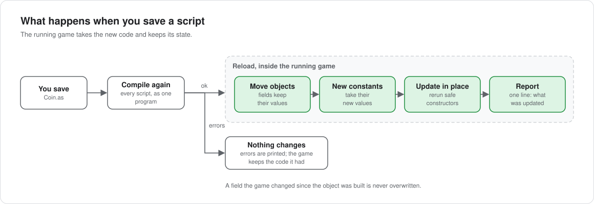

# Hot reload

When you save a script while the game runs, the game takes the new code and keeps its state. You don't
restart the game or the scene. This page explains what a reload does, what it can't do, and why.

Hot reload works when you run a project from its folder in a debug build, on desktop and in the iOS
Simulator. An exported game doesn't watch its scripts.



## What happens when you save

The extension checks the project's `.as` files five times a second. When one changes:

1. **Every script is compiled again,** as one program.
2. **If there's an error, nothing changes.** Godot prints the errors and the game carries on with the code
   it had.
3. **If the scripts compile, every live object moves onto the new code.** A field that kept its name and
   kind keeps its value. Static fields keep theirs. Listeners added before keep listening, and run the new
   code.
4. **Constants take their new values.**
5. **Objects built from old values are updated in place,** where that is provably safe. The next section
   explains the rule.
6. **Godot prints one line** that says what was updated and what wasn't.

```text
ActionScript: reloaded 12 scripts.
ActionScript: objects updated in place: Coin. Not updated: Hud (it extends Godot's Control).
Restart the scene to see the new code on those.
```

## Updating objects in place

New code alone doesn't change an object that already exists. Suppose a constant sets the size of a coin:

```actionscript
// Rules.as
package {
    public class Rules {
        public static const COIN_WIDTH:Number = 24;
    }
}
```

```actionscript
// Coin.as
package {
    public class Coin {
        public var x:Number;
        public var y:Number;
        public var width:Number;

        public function Coin(x:Number, y:Number) {
            this.x = x;
            this.y = y;
            width = Rules.COIN_WIDTH;
        }
    }
}
```

You change `COIN_WIDTH` to 32 and save. The coins on screen were built with 24, and nothing in the new
code would change that. So the reload does what the constructor would do now:

1. For each live `Coin`, it runs the new constructor on a throwaway object, with the arguments the coin was
   built with.
2. It compares the throwaway's fields with the values the coin's constructor gave it originally.
3. A field whose first value changed, and that still holds the old first value, takes the new one.
4. A field the game has changed since is left alone.

Every coin on screen gets the new width. A coin that a magnet has moved stays where the magnet put it. A
second edit starts from what the first one gave.

### When an object is updated

Running a constructor twice is only safe if it has no effect beyond the object it builds. The compiler
proves that for each class, and refuses whatever it can't prove.

| Updated in place | Not updated, and named in the log with the reason |
|---|---|
| A plain AS3 class whose constructors depend only on their arguments and on constants | A class that extends a Godot class. A node's set-up can't be run again on a throwaway. |
| The constructor may compute numbers, Booleans and text, set the object's own fields, and call its own methods that do the same | A constructor that reads or writes a static variable, creates an object, calls Godot, reads the clock or a random number, or prints |
| | An object built with an argument that is an object or a Godot value |

An object that isn't updated behaves as before: a new field starts empty, and a new first value shows on
objects created afterward.

### Restarting when you want to

A reload never restarts the scene on its own. When you want the new code on everything, restart the scene.
The AS3 script language object that the extension registers with Godot has a `restart_scene()` method for
this, which a tool or a GDScript helper can call. It starts the running scene again from its file and says
what that doesn't rebuild, such as nodes outside the scene. A scene whose own `.tscn` file you edited does restart by itself.

## What it costs

To rerun a constructor, the game remembers the arguments each object was built with. It does that only in
a debug build inside Godot, including a native iOS debug export. Release builds omit this bookkeeping.

| Creating and dropping objects, and nothing else | Cost of remembering |
|---|---|
| On the interpreter | About 2.5% |
| On the interpreter, for a class whose constructor can't be rerun, where the first values are kept too | 7% to 9% |
| In native code, two million objects with a text field | 10% more instructions |
| In native code, a frame that creates 20,000 objects of four numbers | 27% more instructions |

Native code pays more in proportion because it does so little else to create an object. A game whose
frames aren't made of object creation sees none of it. A library built with `--remember` that runs where
nothing is remembered, such as an exported game, tests one flag for each object it creates, which costs
about 3% on the same two programs.

## Limits

- **Native code isn't reloaded yet.** Hot reload is a feature of the interpreter. If you edit a script
  while the game runs as native code, the game moves onto the interpreter with its state, and reloads work
  from there. Objects created as native code are updated in place like any others.
- **Native code keeps the arguments, not the first values.** An object created as native code by a
  constructor that couldn't be rerun at the time isn't updated, even after an edit makes the constructor
  rerunnable. The interpreter updates such an object. The log names the class and says why.
- **A program library you build by hand remembers nothing** unless you pass `--remember` to `kas3c cpp`.
- **A real phone can't see the folder you edit.** Reload works in the iOS Simulator, which shares your
  disk. Sending edits to a device is planned.
- **Removing a class that still has live objects stops the reload.** Godot tells you to restart.
- **Static variables keep the values the game gave them.** Restart the game to see a new first value.

## How this compares

The split between reload and restart follows Flutter: a hot reload keeps state, and a hot restart rebuilds
it.
