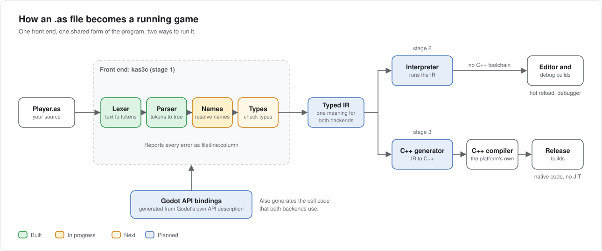
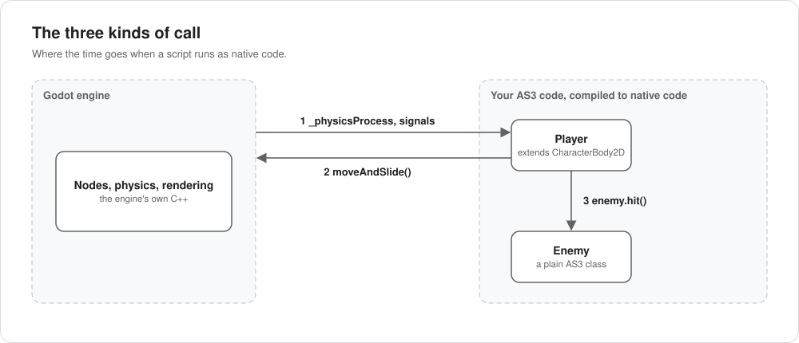

# How it works

Kumikae AS3 has one compiler front end, one form of your program that everything reads, and two ways to run
it. This page follows a script from its `.as` file to a running game.

## The front end

The front end reads every `.as` file in your project as one program.

1. **The parser** turns text into a syntax tree and reports every syntax error with its position.
2. **Name resolution** connects each name to what it refers to: packages, imports, classes, members and
   locals.
3. **The type checker** gives every expression a type and reports a value that doesn't fit where it's used.

Godot's API reaches the front end as ordinary AS3 declarations. A generator reads Godot's own description of
its classes and writes them as AS3, under AS3 naming: `move_and_slide()` becomes `moveAndSlide()`, a
property with a getter and a setter becomes an AS3 property, and a signal becomes a property you add
listeners to. Because the declarations are ordinary source, a misspelled Godot method is a compile error
like any other.

The [language server](../compiler/lsp/README.md) uses the same front end, so your editor shows the same
errors as the compiler.

## The typed IR

The front end's output is lowered to a typed intermediate representation (IR): a flat list of instructions
for each function, in which every value has a known kind. The IR is the single definition of what your
program means. Both ways of running a program read the IR and nothing else, which is what keeps them in
agreement.

## Two ways to run

| | Interpreter | Native code |
|---|---|---|
| Runs your code by | Executing the IR | Compiling the IR to C++, then to machine code |
| You need | Nothing extra | A C++ toolchain for the target |
| Hot reload | Yes | The game moves onto the interpreter and reloads there |
| Speed | For development | Level with or ahead of Godot C# |
| Used for | Editing and debugging | Play and release builds |

**The interpreter** runs inside a Godot extension that stock Godot 4.7 loads. It needs no build step, so you
save a script and the running game takes the change. See [Hot reload](hot-reload.md).

**The C++ backend** writes your whole program as C++ source. The platform's own C++ compiler turns that into
a program library, which the extension loads in place of the interpreter. There is no just-in-time compiler
on any platform, because iOS and consoles forbid one. See [Performance](performance.md) for the techniques.

The extension builds the program library for you when you press Play. On macOS this is on by default: the
first run after an edit starts on the interpreter while the library builds in the background, and the next
run is native. Builds are cached under `.godot/kas3`. When you save a script while the game runs as native
code, the game moves onto the interpreter with its state and takes the change. The project setting
`actionscript/native/play` turns the build off. You can also build a library by hand with `kas3c cpp`. If
there's no C++ toolchain, or a build fails, the extension says so once and runs the interpreter.

### Keeping the two identical

A program must print the same output and raise the same errors on both. The test suite runs every program
in `compiler/tests/run/` on the interpreter and as native code and compares the results, and runs the Godot
test scenes both ways. A difference between them is a failing test.

## Inside Godot

A script takes part in three kinds of call:

1. **Godot calls your script,** for `_process`, `_physicsProcess` and signal listeners. Godot calls by name
   with boxed arguments, as it does for C# and GDScript. The extension looks the name up once and keeps the
   answer.
2. **Your script calls Godot,** for example `moveAndSlide()`. The call goes through Godot's typed
   direct-call path, with no boxed values and no lookup by name.
3. **Your script calls your own code,** for example `enemy.hit()`. In native code this is a direct C++
   call that never touches the engine.

A script class that extends a Godot class is attached to a node. A plain AS3 class has no node behind it:
it's an object your scripts own. Objects are reference counted, and a collector that runs in short steps
each frame frees objects that refer to each other in a cycle.

## Errors

Nothing is silently wrong. A runtime failure is an AS3 error with a message, the `.as` file and the line:
a `null` used as an object, an index out of range, a value of the wrong type arriving from Godot, or a Godot
object used after Godot freed it. Uncaught errors appear in Godot's own error panel. The native code raises
the same errors as the interpreter.

## Where the code lives

| Folder | Role |
|---|---|
| [`compiler/src/`](../compiler/src/README.md) | The front end |
| [`compiler/ir/`](../compiler/ir/README.md) | The typed IR and the lowerer |
| [`compiler/vm/`](../compiler/vm/README.md) | The interpreter |
| [`compiler/backend_cpp/`](../compiler/backend_cpp/README.md) | The C++ backend |
| [`compiler/runtime/`](../compiler/runtime/README.md) | What generated C++ is built against |
| [`compiler/godot_ext/`](../compiler/godot_ext/README.md) | The Godot extension |
| [`compiler/lsp/`](../compiler/lsp/README.md) | The language server |
| [`compiler/godot/`](../compiler/godot/README.md) | The generator of Godot's API as AS3 |

Each layer depends only on the ones before it. The front end knows nothing of the IR, the interpreter
includes no Godot header, and only the extension includes Godot's C++ bindings.
