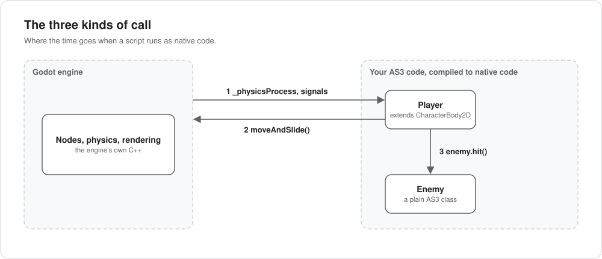

# Performance

The goal is for AS3 compiled to native code to match or beat Godot C#. This page shows the current numbers,
how they're measured, and the techniques behind them.

## Results

Median frame time in microseconds, lower is better. Each benchmark is the same program written in AS3 and in
C#, run in a release export of Godot 4.7 on macOS (Apple silicon).

| Benchmark | What it stresses | C# | AS3 native | AS3 / C# |
|---|---|---|---|---|
| `move_nodes` | One script moves 20,000 nodes | 907 | 999 | 1.10x |
| `per_node_process` | A script on every node | 2,518 | 2,248 | 0.89x |
| `signal_traffic` | 20,000 signals a frame | 1,608 | 1,536 | 0.96x |
| `ray_queries` | Physics ray queries | 2,098 | 2,071 | 0.99x |
| `array_conversion` | Arrays handed to Godot | 460 | 329 | 0.72x |
| `nbody` | Floating-point math on objects | 96 | 90 | 0.94x |
| `sieve` | Integer arrays | 585 | 568 | 0.97x |
| `saxpy` | Number arrays | 439 | 309 | 0.70x |
| `shapes` | Overridden methods | 168 | 94 | 0.56x |
| `alloc` | 20,000 short-lived objects a frame | 111 | 109 | 0.98x |

Read the table with these limits in mind:

- **Measured on 2026-11-17 on a machine doing other work.** Run-to-run spread is larger than several of the
  differences. Treat anything between 0.9x and 1.1x as level. `move_nodes` measured 1.04x on a quiet
  machine.
- **`array_conversion` comes from an earlier run** than the other rows.
- **Medians hide C#'s collector.** On `alloc`, C#'s slowest frame in a hundred takes 627 µs, more than five
  times its median. Native AS3's takes 123 µs.
- **Only macOS on Apple silicon has been measured.**

### Measure it yourself

The benchmarks are in [`compiler/tests/bench/languages/`](../compiler/tests/bench/languages). You need a
.NET build of Godot with export templates.

```bash
KAS3_GODOT_DOTNET=/path/to/godot-dotnet python3 compiler/tests/bench/languages/run.py
```

Two rules keep the comparison fair. Runs of the two languages alternate, so that load on the machine hits
both. And C# is measured only after .NET has finished optimizing the script: in its first few hundred frames
C# runs two to three times as many instructions as it settles to.

## Where the speed comes from



A frame of script time splits into your code calling Godot, Godot calling your code, and your code calling
itself. Each has its own techniques.

### Compile the whole program ahead of time

The C++ backend sees every class in your program at once, and the platform's C++ compiler optimizes the
result. Nothing is compiled while the game runs, so there's no warm-up and the first frame is as fast as the
last.

- **A method call is a C++ call.** Calling a method of your own class never touches the engine.
- **Overridden methods are dispatched by comparing classes.** Because the program is closed, the compiler
  knows every class that can be behind a call. A method with one implementation becomes a direct call. A
  method with a few becomes a class comparison followed by a direct call, which the C++ compiler can
  inline. C# reaches the same result by guessing at run time.
- **Fields are C++ struct members.** The C++ compiler knows which field a write changes, so it keeps values
  in registers across a loop instead of reloading them.

### Call Godot directly

- **Typed calls, prepared once.** Each call into Godot is resolved to Godot's own function pointer the first
  time it runs. After that, arguments pass as plain values, with no boxing and no lookup by name.
- **Signals go straight to the engine.** `emit()` calls Godot's emit function with values built where Godot
  reads them. A listener that receives exactly the types it declares is entered with no conversion.
- **Node handles are shared, not copied.** A script's reference to a node is one shared handle. The node
  behind it is cached, and Godot notifies the runtime when a node is freed, so the cache is never stale. A
  freed node is still an AS3 error, never a crash.

### Keep values where they're used

- **`Vector2` values live inline.** A `Vector.<Vector2>` stores the values themselves, not a reference to
  each. It goes to Godot as a packed array in one copy.
- **Integer vectors use four bytes an element,** as a C# `int[]` does.
- **Numbers held as untyped values aren't allocated.** A `*` or `Object` that holds a number or a Boolean
  costs no allocation and no reference count.

### Count references only when needed

Objects are reference counted, which keeps frame times steady because memory is freed where it's dropped.
The compiler removes the counting where it can prove an object stays alive:

- An element read from a vector and used at once borrows the vector's reference.
- An object stored as the last thing done with it hands its reference over.
- Creating or dropping an object that holds only numbers and text is known to run no other code.

A collector frees objects that refer to each other in a cycle. It runs in short steps each frame, and skips
containers whose elements can't hold a reference.

## Keeping fast code correct

Every shortcut above rests on a fact the compiler has proved. Three checks guard those facts:

- **The same output on both back ends.** Every test program runs on the interpreter and as native code, and
  the outputs must match line for line.
- **Tests written to break the shortcut.** Each proof has a test program that would print a wrong answer if
  the proof were wrong: a method that removes its own receiver from the list being iterated, an override
  added in a subclass, a node freed in the middle of a call.
- **Sanitizers.** The test suite runs under address and undefined-behavior sanitizers, including the Godot
  extension loaded into Godot.

## The interpreter

The interpreter exists for development: no build step, and hot reload. It's several times slower than native
code and isn't meant for release builds.

## What's next

- Build the native code for you when you press Play.
- Native code on iOS and in exported games.
- Larger Godot values (`Vector3`, `Color`) inline in vectors, fields and parameters.
- Threads.
