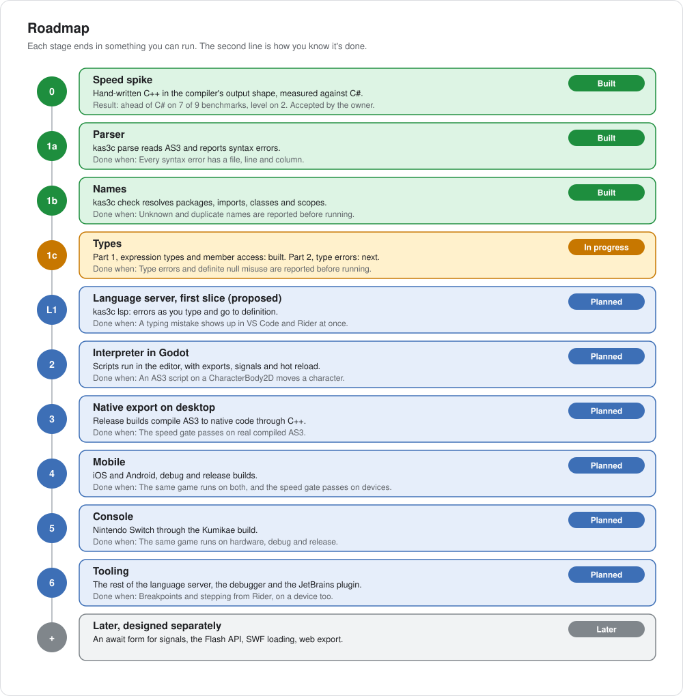

# Roadmap

This page says what Kumikae AS3 does today, what is being built, and what comes later. It changes when the
state of the project changes.

## Goals

| Goal | What it means |
|---|---|
| First-class in Godot | Scripts extend Godot classes, attach to nodes, export properties and use signals. |
| One codebase | The same source runs on desktop, mobile and consoles, with no per-platform code. |
| As fast as C#, or faster | Release builds are native code, measured against Godot C# on the same benchmarks. |
| Easy to use | Write a script and press Play. Save, and the running game changes. |
| Easy to debug | Errors with a file and a line everywhere, and breakpoints from the IDE. |

## Built

### The compiler

- **Parser, name resolution and type checking** for ActionScript 3, checked against about 190,000 lines of
  open-source AS3.
- **Godot's whole API as typed AS3:** 1,036 classes, with operators on `Vector2` and the other math types,
  and Godot's 64-bit integers as an `Int64` type.
- **Every error has a file, a line and a column.**

### The language at run time

- **Classes, interfaces, accessors, closures, rest parameters,** `try`/`catch`/`finally`, labeled `break`
  and `continue`.
- **`Array`, `Vector.<T>`, `Dictionary`, `Object` literals,** untyped values (`*`), `for in` and `for each`.
- **The standard library:** `String`, `Number`, `Math`, `JSON`, `Date`, `RegExp`, and the top-level
  functions.
- **AS3's runtime errors,** with stack traces that name the `.as` file and line.

### Inside Godot

- **Scripts on nodes:** properties, methods, signals, singletons, constants, static methods and global
  functions, with what Godot returns checked against its declared type.
- **`[Export]` and `[Signal]`.**
- **Hot reload** that keeps state and updates live objects in place. See [Hot reload](hot-reload.md).
- **Memory:** reference counting, with a cycle collector that runs in short steps each frame.
- **iOS:** the interpreter runs in the Simulator and has run on a device.

### Native code

- **`kas3c cpp` writes a program as C++,** and the Godot extension loads the compiled library.
- **Every test program gives the same output** on the interpreter and as native code.
- **Level with or ahead of Godot C#** on all ten frame benchmarks. See [Performance](performance.md).

### Editors and tools

- **Language server:** errors as you type, completion, signature help, go to definition, find references,
  hover and outline. A change to a million-line project is checked in milliseconds.
- **Rider plugin:** language support, a project wizard, a `project.godot` settings editor, run
  configurations for desktop and the iOS Simulator, a live Simulator panel, and a test runner.
- **VS Code client** for the language server.
- **A testing library** written in AS3.

## In progress

- **Play builds native code for you.** Today you compile the program library by hand. The extension will
  build it when a project runs, cache it, and fall back to the interpreter when there's no C++ toolchain.

## Next

1. **Native code on iOS and in exported games.**
2. **Hot reload for native code.**
3. **Godot's larger values inline:** `Vector3`, `Color` and the rest in vectors, fields and parameters.
4. **Threads.**
5. **A restart action in the IDE,** to go with hot reload.
6. **Debugger:** breakpoints and stepping from Rider, in the editor and on a device.
7. **Android, Windows and Linux.** The code is written to be portable, and none of the three has been built
   or run.
8. **Consoles.** Console support lives in a separate repository, because console SDKs are confidential.

## Later

These are designed separately. Nothing above delivers them, and the design keeps each possible.

- `async` and `await`, with work off the main thread.
- Language additions from Apache Royale, such as arrow functions, `?.` and `??`.
- The Flash API (`flash.display.Sprite`, `MovieClip`) as a library on top of Godot nodes.
- Loading `.swf` files.
- Web export.

## Known limits

- **Only macOS is tested.** Godot 4.7 on Apple silicon is the one configuration the test suite runs on.
- **A cycle through a Godot `Array` or `Dictionary` isn't collected.** The collector follows AS3 objects,
  Godot's reference-counted objects and listeners.
- **Godot's string-format operator (`"%s" % value`) isn't available.** Use AS3 string concatenation.
- **A script class with the same name as a Godot class is ambiguous** when it's in the default package. Put
  it in a package.
- **The 60 Godot methods that take raw pointers aren't exposed.**
- **`super` can't reach a virtual method implemented by another C++ extension.** Godot's extension
  interface has no such call.
- **The first editor scan of a new project can crash as Godot exits,** if Godot is told to quit at once
  (`--import`). The fault is in Godot's documentation thread. Later runs are clean.
- **The Rider plugin has been validated by automated editing checks,** and needs wider use by people.

## Design decisions

| Topic | Decision |
|---|---|
| Naming | Godot's API uses AS3 conventions: lowerCamel methods, properties instead of accessors, signals as properties. `_ready` keeps its underscore. Five Godot names that clash with AS3's get a `Godot` prefix, such as `GodotObject`. |
| Where AS3 doesn't decide | C#'s behavior in Godot is the reference. |
| No JIT | Native code is always compiled ahead of time, because iOS and consoles forbid generating code at run time. |
| Integers | A Godot integer is an `Int64` unless Godot says it's narrower. It converts to `int` or `Number` with a range check, never silently. |
| Freed Godot objects | A freed object reads as `null`. Using it is an AS3 error with a line number, never a crash. |
| Values held in place | A `Vector.<Vector2>` or `Vector.<Vector2i>` holds the values themselves and can't hold `null`, as in C#. |
| Static fields and null calls | Both follow Flash: a class's static fields are set on its first use, and a call on `null` evaluates its arguments before raising the error. |
| Signals shared by the whole game | On a singleton's signal, `removeAll()` removes only the calling script's listeners. |

## Terms

| Term | Meaning |
|---|---|
| Front end | The part of the compiler that reads source code and checks it. |
| IR | Intermediate representation: the compiler's own form of the program, between source and running code. |
| Back end | A way of running the IR. This project has two: the interpreter and the C++ backend. |
| Program library | Your scripts compiled to native code, as a library the Godot extension loads. |
| JIT | Just-in-time compiler: one that produces machine code while the game runs. This project never uses one. |
