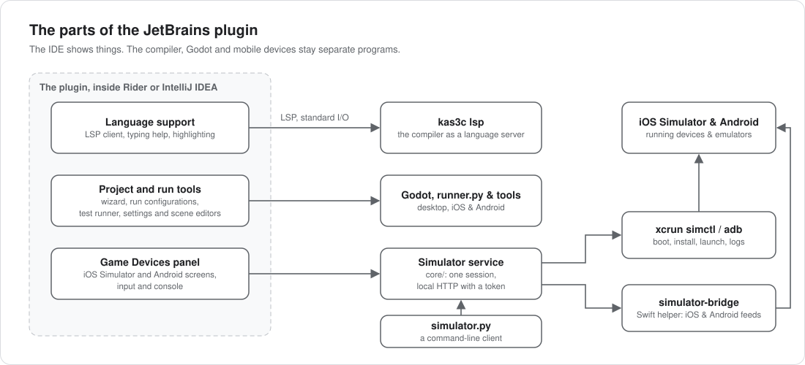

# Plugin architecture

This page describes the parts of the plugin and the rules each follows. It's for someone changing the
plugin. For the coding conventions, read [CONTRIBUTING.md](CONTRIBUTING.md). For what the plugin does,
read the [README](README.md).



The plugin has three parts: language support, project and run tools, and the iOS Simulator panel. Two
rules hold across all three:

- **The compiler owns the language.** What a name means, what completes, and what is an error come from
  `kas3c`. The plugin holds no AS3 semantics.
- **The IDE owns interaction.** Edits, snippets, undo and the Tab key go through the platform's own
  pipeline. The plugin doesn't override them.

## Layout of the code

| Path | Holds |
|---|---|
| `src/main/kotlin/.../language/` | The language clients, the local lexer, and typing help |
| `src/main/kotlin/.../project/` | The project wizard, file templates, and the Game view |
| `src/main/kotlin/.../run/` | The Godot and iOS Simulator run configurations |
| `src/main/kotlin/.../testing/` | The AS3 Tests run configuration and its result tree |
| `src/main/kotlin/.../settings/`, `.../scene/` | The `project.godot` and scene editors |
| `src/main/kotlin/.../panel/` | The Simulator tool window: repository, controller, view |
| `src/main/kotlin/.../ui/` | The Compose host and the shared composables |
| `src/main/resources/META-INF/` | `plugin.xml` and the optional descriptors for Rider and IntelliJ IDEA |
| `core/` | The Simulator service. Plain Kotlin with no IDE imports. Also the standalone `kumikae-simulator` program |
| `native/SimulatorBridge/` | The Swift helper that reads the Simulator's screen and sends input |
| `simulator.py`, `tests/` | The command-line client and its tests |
| `tools/build-ios-simulator.sh` | Builds a game for the iOS Simulator. The plugin carries it |
| `src/test/kotlin/`, `src/uiProbe/` | Tests, and a test-only plugin that drives the real views in a sandbox IDE |

## Language support

### Two clients, one server

Both IDEs talk to the same `kas3c lsp`. The descriptors keep the two clients apart:

| Descriptor | Loaded | Holds |
|---|---|---|
| `plugin.xml` | Always | The file type, typing help, project tools and the Simulator panel |
| `as3-rider.xml` | In Rider | Rider's own LSP client (`As3LspSupportProvider`) |
| `as3-idea.xml`, `as3-idea-lsp4ij.xml` | In IntelliJ IDEA, the second only with LSP4IJ | The LSP4IJ server, parameter help and outline |

Rider never loads an LSP4IJ class, even when that plugin is installed, and IntelliJ IDEA never loads a
class of Rider's client. An IntelliJ IDEA project without LSP4IJ gets one notification when an AS3 file
opens. The listener that shows it imports no client class, so a missing dependency can't break typing
help.

`As3ServerLaunch` owns the server's command line for both. `As3ProjectLanguageService` finds the compiler
(`CompilerLocator`) and refreshes Godot's declarations, on one project-owned alarm.

### Diagnostics and document versions

An editor that types ahead can receive errors for text it no longer has. Both clients guard against it:

- **Rider.** Rider sends a change before the document is written. The plugin validates the version of a
  diagnostics message and stores the message in one read action, so that a reply can't cache old offsets
  under a new version.
- **IntelliJ IDEA.** `As3Lsp4ijDiagnostics` rejects a range outside the current document.
  `As3Lsp4ijClient` rejects a reply while an edit is uncommitted, and refreshes highlights after a
  publication.

The server stays the source of what the errors are.

### Completion in LSP4IJ

`As3Lsp4ijCompletion` refreshes suggestions as the prefix changes, and chooses the insert range for Enter
and the replace range for Tab. The lookup owns its data. There's no item cache at project or application
level. Snippets, additional edits and undo stay in the client.

### The local lexer and typing help

`As3ParserDefinition` creates a token-only PSI, which is enough for editor integration. `As3Lexer` tells
code from comments, strings and regular expression literals.

- **The lexer can restart anywhere.** Its whole state fits in the sixteen bits the editor keeps for each
  token, so the editor lexes again from a token near an edit, not from the top of the file. The state
  records whether each open brace began a block or a value, which decides whether a `/` after its `}`
  starts a regular expression or divides.
- **Colors come from TextMate.** `As3EditorHighlighterProvider` combines the lexer's token kinds with the
  colors of the TextMate grammar shared with the VS Code client.
- **Typing handlers are local.** `As3BraceMatcher`, `As3QuoteHandler`, `As3LineIndentProvider` and
  `As3EnterHandler` use the tokens. None reads a file, starts a process or waits for the server.

### Repairs to Rider

On the one Rider build the plugin was tested with (`RD-262.10968.170`), the `Rider*Lifetime` classes
release objects of Rider's own that would otherwise outlive a closed project. They run only on that exact
build, check the signatures of what they call before they call it, and change no IDE file. Each repair
reports its failure independently.

The plugin verifier can't check reflective calls. Before you change the supported build, run the sandbox
probes described in [CONTRIBUTING.md](CONTRIBUTING.md#checks-in-a-sandbox-ide).

## Project tools

- **`settings/`** separates four things: models that preserve the source text, a draft controller, a
  repository over the IDE's documents, and the Compose form. The repository validates the whole draft and
  changes the documents in one write command. A conflicting source edit is rejected.
- **`scene/`** parses node and resource headers and edits only a script attachment. It refuses scene
  inheritance it doesn't understand.
- **`testing/`** connects the IDE's test runner to the repository's Python runner
  ([testing/](../../testing/README.md)). It adds no AS3 reflection and no compiler syntax.
- **`run/`** starts Godot for the desktop configuration. For the Simulator it builds the game with
  `tools/build-ios-simulator.sh` and installs and launches it through the Simulator service.

## The Simulator panel

```text
SimulatorToolWindowFactory   entry point: resolves IDE paths, builds the window
  SimulatorComposition       chooses the concrete services
    LocalSimulatorService    starts the shared session
    ApiSimulatorRepository   typed commands, pictures and decoded frames
    BackgroundWorker (x4)    actions, polling, stream startup, continuous touch
  SimulatorWindowController  every request and all state
  SimulatorToolWindow        mounts the view; owns the two native controls
    SimulatorView            Compose: a tab for the list and one for each running device
    DeviceListPage           every simulator, each with Boot or Shut down
    DevicePage               toolbar, framed device with zoom, console drawer
    SimulatorScreen          native: paints the picture, turns the mouse into gestures
```

### The service

`core/` wraps `xcrun simctl` in a local HTTP service protected by a token. [protocol.md](protocol.md)
describes it. It's a separate Gradle module because it's also the standalone program that a script can
run without an IDE.

- **One session.** The panel and `simulator.py` share one selected device, one geometry and one console.
- **Commands go over HTTP for both.** The panel reads pictures from the session directly, in process, so
  no image is encoded as base64 or JSON.
- **Slow operations run outside the session's lock.** Boot, shutdown and install can take two minutes. They
  run one at a time, and a second is refused with `BUSY`. Status, the device list, the log and pictures
  still answer.
- **The service reaps only the processes it started.** A JVM shutdown hook waits for them if the IDE exits
  while the session is still closing.

### The native helper

With the input switch on, `LocalSession` starts the Swift helper in `native/SimulatorBridge/`.

- `NativeBridgeConnection` checks that the helper is ready and sends small control messages.
- The helper writes each frame into a memory-mapped slot. `NativeFrameReader` copies a new frame out under
  a shared file lock, and `NativeFrameFeed` does that work off the UI thread and keeps only the newest
  frame.
- A failure to start reaches the panel, which retries with a bounded backoff. There's no other backend to
  fall back to.

[The helper's README](native/SimulatorBridge/README.md) lists the private interfaces it uses.

### Repository

`SimulatorRepository` is the typed boundary: devices, status, select, boot, install, launch, screenshot,
console page and input. `ApiSimulatorRepository` is the only panel class that reads or writes protocol
JSON. Nothing above the repository sees JSON, HTTP or a process.

### Controller

`SimulatorWindowController` owns every request and every piece of state the window shows, as Compose
observable state. It never creates or touches a Swing component, so its tests need no IDE and no window.

- **One action at a time.** A second action while one runs is refused, and the status line says so. Nothing
  is queued: a tap that runs seconds late is worse than a tap that visibly didn't happen.
- **Stale pictures are dropped.** Selecting a device, booting, launching, rotating and any failure advance
  a picture epoch. A poll remembers the epoch it started under, and its result is dropped if the epoch has
  moved.
- **The list and the selection always agree,** even when a selection is refused because an action is
  running. An action must never name a device the user can't see.
- **No console output is lost or shown twice.** The log cursor advances with every page, independent of
  the picture epoch.
- **A failed action is never retried automatically.** A lost reply doesn't prove that a boot or a launch
  did nothing.
- **A hidden window doesn't poll or stream.**
- **After disposal, nothing is delivered.** A result that arrives late changes nothing. Closing hands its
  slow part to its own thread, because it waits for a running command.

### View

`SimulatorToolWindow` mounts `SimulatorView` through `ui/ComposeHost.kt`, which ties the composition to the
controller's disposal. Compose owns the layout and whether buttons are enabled.

- **Two controls stay native:** `SimulatorScreen`, which paints the picture and turns mouse presses into
  gestures, and the console's text area.
- **Dialogs, menus and the clipboard are behind `SimulatorPrompts`,** which is injected, so the view opens
  nothing itself and a test can answer for a person.
- **A new frame repaints only the screen.** The device's body is cached as one image (`DeviceBodyCache`,
  at most 16 MiB), so live frames don't redraw it.

### Compose Swing

The UI uses Compose Swing UI: the Compose runtime driving Swing components, with no separate renderer. The
library is an alpha, pinned in `build.gradle.kts`. That's why the plugin accepts only the range of IDE
builds between the two it was tested on.

## How it's tested

| What | How |
|---|---|
| The service: protocol, geometry, device parsing, commands, the log buffer, timeouts, cleanup, authentication | `core` tests |
| The repository | `ApiSimulatorRepository` against a fake JSON transport |
| The controller | `ManualBackgroundTasks`, a scheduler that separates running work from delivering its result. It reproduces stale pictures, late delivery and overlapping actions without sleeping |
| The local service | `LocalSimulatorServiceTest` starts the real service in a temporary folder. It needs no Simulator |
| The command-line client | `python3 -m unittest discover -s tests`, against a fake local service |
| Compatibility with the IDE's API | `./gradlew verifyPlugin` |
| Views and typing in a real IDE | The UI probe, in a sandbox. See [CONTRIBUTING.md](CONTRIBUTING.md#checks-in-a-sandbox-ide) |
