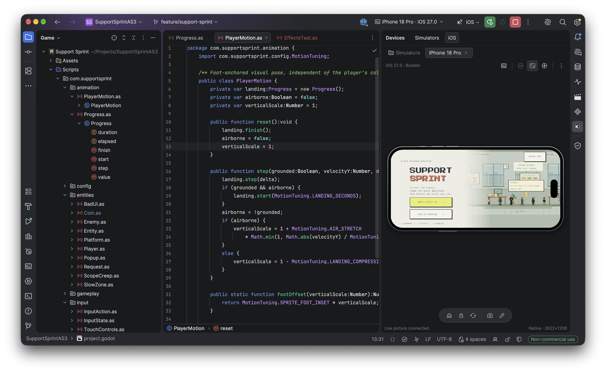
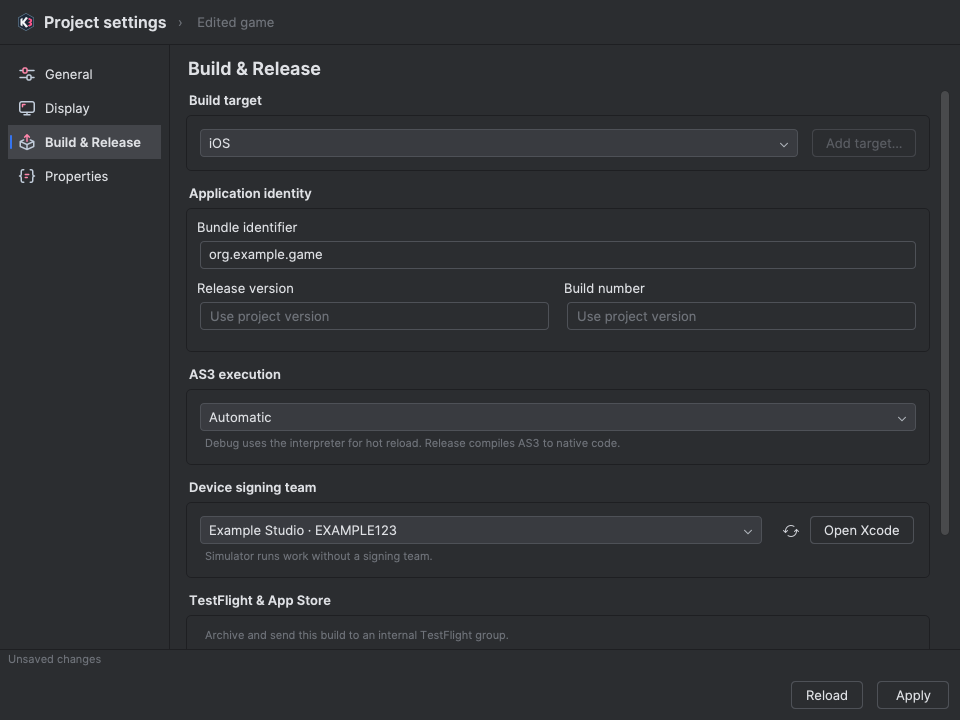
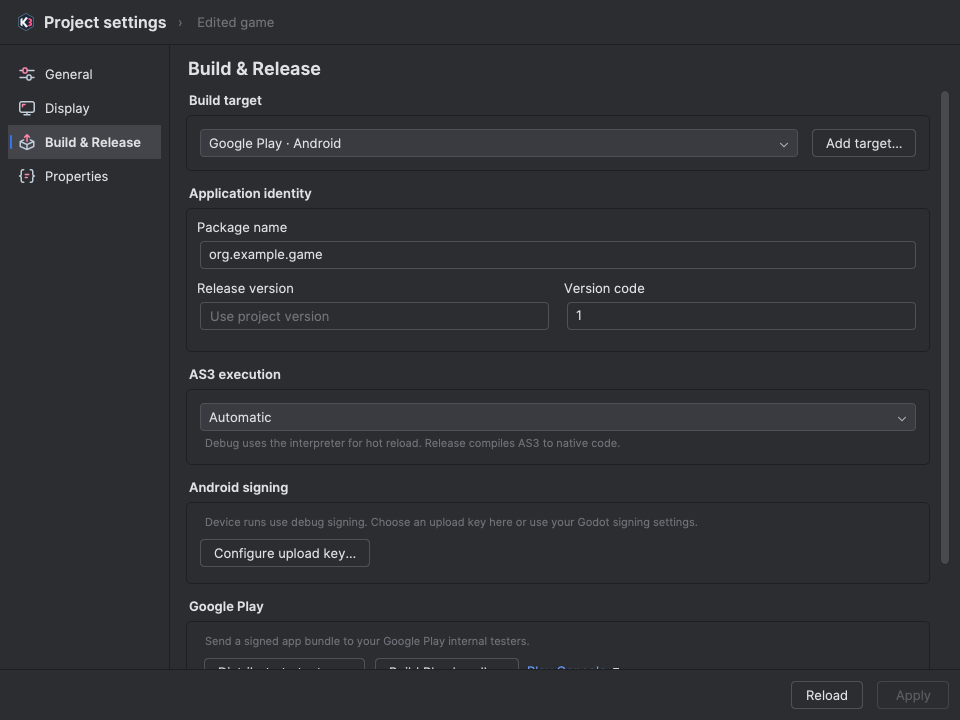
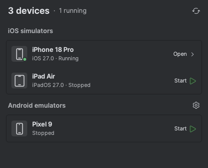
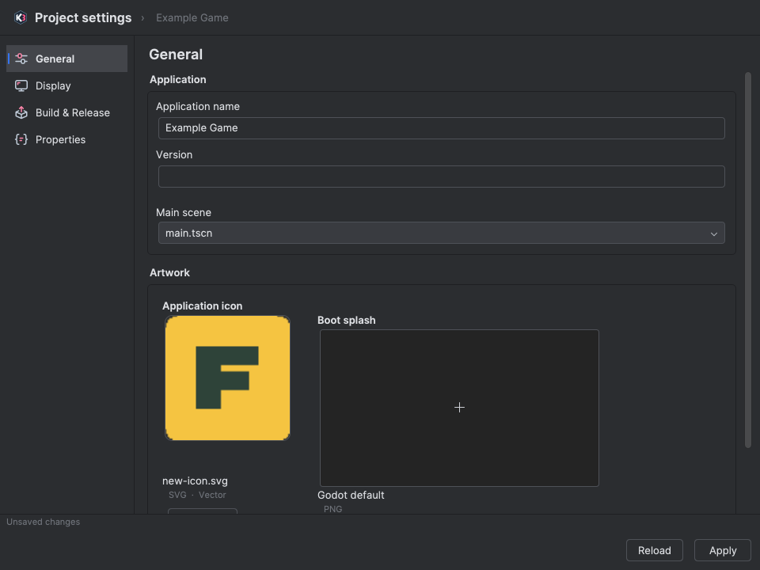
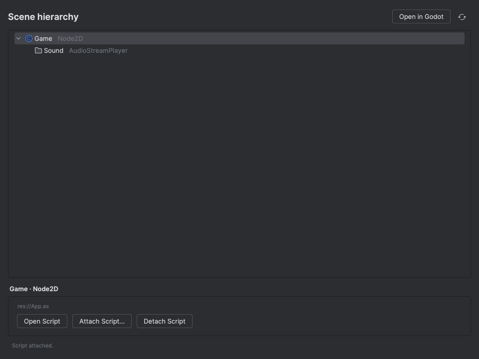

# Kumikae AS3 for Rider and IntelliJ IDEA

A plugin for writing Godot games in ActionScript 3. It adds language support, a project wizard, run
configurations for desktop, Web, iOS and Android, embedded device displays, a test runner, and editors
for `project.godot` and scenes.

This page is for someone using the plugin. To change it, read [ARCHITECTURE.md](ARCHITECTURE.md) and
[CONTRIBUTING.md](CONTRIBUTING.md).



*The **Game** view (left) shows compacted AS3 packages alongside expandable classes, fields, and methods; the editor (center) provides live diagnostics and navigation; and **Devices** (right) streams the running iOS Simulator with interactive input.*

## Requirements

| | |
|---|---|
| IDE | Rider 2026.2, or IntelliJ IDEA 2026.1. The plugin accepts builds 261.22158.277 through 262.10968.170, and has been checked on those two |
| IntelliJ IDEA only | The LSP4IJ plugin, version 0.21.0. Rider uses its own language client |
| Operating system | macOS. The Simulator panel exists only on macOS. Windows and Linux are untested |
| To run a game | Godot 4.7 |
| For the Simulator | Xcode |

There is no AS3 debugger yet.

## Build the plugin

You need a JDK 25, and Rider 2026.2 installed. The build compiles against the installed IDE and never
downloads one.

Build the compiler first, so that the plugin bundles `kas3c`. Build the Godot extension too if you want the
project wizard to set up new projects with it. See [the compiler's README](../../compiler/README.md#build-and-test).

From this folder, with `JAVA_HOME` set to the JDK 25:

```sh
./gradlew buildPlugin
```

The zip is written to `build/distributions/`.

| What the build needs | Where it looks |
|---|---|
| Rider | `RIDER_HOME`, or `/Applications/Rider.app` |
| Gradle and the libraries | Downloaded by the Gradle wrapper on the first build. Add `--offline` after that |
| Swift 6, for the Simulator helper | The installed Xcode. Without it, the helper is skipped and the build says so |

## Install the plugin

1. In the IDE, open **Settings > Plugins**.
2. Click the gear icon and choose **Install Plugin from Disk**.
3. Select the zip file from `build/distributions/`.
4. Restart the IDE. Installing, updating and uninstalling all need a restart.

In IntelliJ IDEA, install **LSP4IJ** from **Settings > Plugins** as well. If it's missing, the plugin shows
a notification when you open an AS3 file. Typing help works without it, and completion and errors don't.

### How the plugin finds the compiler

The plugin uses the first `kas3c` it finds, in this order:

1. A build in the project or in a folder above it: `compiler/build/kas3c` or `build/kas3c`.
2. The one bundled with the plugin.
3. The `PATH`, then `/opt/homebrew/bin` and `/usr/local/bin`, then `~/.local/bin`.

Rebuilding the compiler elsewhere doesn't update the copy inside an installed plugin. Rebuild and
reinstall the plugin to update it.

## Language support

Errors as you type, completion, signature help, go to definition, find references, hover and outline come
from the compiler's language server. Bracket pairing and indentation are the plugin's own. See
[Completion and typing help](../completion.md).

File and package names follow the compiler’s reserved-word list, bundled when the plugin is built.
For example, you can create `native.as`, while `class` is reserved.

## Create a project

Choose **File > New Project > Kumikae AS3 Game**. On an Apple silicon Mac the wizard checks for a stable
Godot 4.7 installation. If it cannot find one, choose **Install Godot 4.7.2** to download and verify
the official Mac app, or **Choose existing…** to select an app or executable. Installation is per user
and needs no administrator password. Click **Create** to use that engine for runs, tests and exports.

The wizard creates a small game that runs: a
`project.godot`, a scene, two scripts, and the extension's files.

- **Package name.** The app's identifier, such as `com.studio.game`. Left empty, it's made from the
  project's name.
- **Where the game should run.** Desktop is always included. Choosing iOS adds an iOS export preset and a
  run configuration for simulators and physical devices. Choosing Android or Web adds its export preset and run configuration.
  Companion plugins can contribute additional targets. After setup, select the target under **Build & Release → Build target** to open its settings.

## Run the game

Opening a project that has a `project.godot` and at least one `.as` file adds a run configuration named
**Game**, of the type **Kumikae AS3 > Game**. Press Run. The game starts in Godot, and what it prints
appears in the Run window.

| Field | Left empty |
|---|---|
| Godot | Found on the `PATH`, in `/opt/homebrew/bin` or `/usr/local/bin`, or in `/Applications` |
| Project folder | This project |
| Scene | The project's main scene |

Edit a script while the game runs and save. The game takes the new code and keeps its state. See
[Hot reload](../../docs/hot-reload.md).

## Add a run target

In **Run > Edit Configurations…**, click **+**, then choose **Kumikae AS3 > Web**, **iOS**, or **Android**.
Click **OK** or **Apply**. Rider selects the platform’s runnable export preset if one exists. Otherwise it
reuses an existing preset for that platform or creates one with the game’s settings. You can also use
**Run > Add Game Target…** to explicitly choose or name a preset.

## Run in a browser

Select **Web** in the project wizard or choose **Run > Add Game Target… > Web** in an existing game.
Select its run configuration and press **Run**. The plugin builds the selected Godot preset, serves the
export on localhost and opens the URL in your default browser. **Stop** closes the preview server and removes the temporary export.
Install the matching Godot Web export templates and use a plugin kit with the WebAssembly runtime. The build stages the host editor extension alongside it so Godot can pack the selected AS3 scripts.
For an existing preset, enable **Extensions Support**, disable **Thread Support**, and include `*.as`.
Use **Export Game** to create a release build for hosting.

## Run on iOS or Android

Open **Run > Add Game Target…** and choose a Godot export preset. In **Devices > Devices**, start
an iOS simulator or Android emulator, select it in the run toolbar, and press **Run**. The plugin reads the
application identifier from the preset, exports and builds the game, installs it, and launches it.

- **iOS Simulator** requires Xcode and a Simulator runtime. Run defaults to the AS3 interpreter with hot
  reload. The iOS preset’s **AS3 execution** setting also supports native builds.
- **iPhone or iPad.** Pair the device in Xcode, enable Developer Mode and unlock it. In **project.godot →
  Settings → Build & Release**, open the iOS preset, choose a **Device signing team** and click **Apply**.
  If the team is blank, Run can use a single local Apple Development signing identity. Select the device
  in the Run toolbar and press **Run** to sign, install and launch the game. Follow its console in the Run
  window. To install an existing signed build with the same bundle identifier, set **Signed device .app**
  in the run configuration.
- **Android** requires the Android SDK, NDK, matching Godot export templates and an ARM64 emulator or
  device. Debug runs default to the AS3 interpreter, and release exports compile AS3 to native ARM64 code
  (`libkas3_program.so`). In **project.godot → Settings → Build & Release**, the Android preset also has
  the **AS3 execution** override (`Automatic`, `Interpreter`, or `Native`).
- On macOS, the plugin bundles the AS3 runtimes and Simulator template when built alongside the compiler.

## Release a mobile game

Open **project.godot → Settings → Build & Release** and select the target. Each preset has its own application
identifier, release version and build number or version code.





### Send a build to testers

Click **Distribute to testers…**. Rider shows the account, app identifier, version, build, and destination
before you confirm. Follow the build and upload in the Run console. The latest result appears under the
selected target the next time you open settings.

- **TestFlight.** Register the app and create an internal testing group in App Store Connect. Choose
  your Apple Developer Program team in Rider. **Open Xcode** takes you to Xcode if you need to add an
  Apple account, then refresh the team picker. On the first delivery, choose an App Store Connect team
  API key (`.p8`) with access to this app and permission to upload and manage internal builds. Enter
  its issuer ID. Rider reads the key ID from the standard filename. Choose your internal group and confirm.
  Xcode archives the game and uploads it for internal testing. Rider follows processing and assigns the
  build to the chosen group. Apple also distributes to groups configured for automatic distribution.
  To resume after closing Rider, distribute the same version and build number again.
- **Google Play.** Set up the app and its internal testing track in Play Console. Choose the app’s upload
  keystore under **Android signing** or create one for a new app. Keep a backup of the keystore and password.
  For the first store connection, select a Google Cloud **Desktop app** OAuth client JSON with the Google
  Play Developer API enabled, then **Sign in with Google** in your browser using an account with testing-track
  release access. A studio can preconfigure the client by setting `KUMIKAE_PLAY_OAUTH_CLIENT` to its
  absolute path in Rider’s environment. Confirm **Internal testing** to build and upload a signed Android
  App Bundle. Manage your tester list in Play Console. [Google Play API setup](https://developers.google.com/android-publisher/getting_started)

Keep store credential files outside the game folder. Rider remembers the connection in its password
store. **Disconnect account** clears the saved store connection for this app and preset. Running a
simulator or emulator works without a store account.

### Prepare a public release

On iOS, choose **Prepare Xcode project…**, open the result in Xcode, and use **Product → Archive** and
Organizer’s **Distribute App** workflow. Select the uploaded build for App Review in App Store Connect.
On Android, choose **Build Play bundle…** for a signed `.aab`, then open **Play Console** to create a
production release.

**Export** and **Export All** build the formats configured in Godot. Preparing a store product applies
its format to a temporary project copy so the same target remains available for local runs.

## The Devices panel

Open **View > Tool Windows > Devices** to start and view simulators and Android emulators.



- **Devices** groups devices by platform, with running devices first. Choose **Open** to view a running
  device or **Start** to boot one. On macOS the list also includes iOS simulators. The gear beside
  **Android emulators** selects **Device default**, **Host GPU** or **Software** for the next start.
- Installed plugins can add hardware to the device list. Choose **Refresh** after connecting or disconnecting a device. Choose **Select** to use a connected device for Run.
- **iOS** shows the selected simulator's screen, input controls and console.
- **Android** shows the selected emulator's screen and forwards pointer input.

### Live picture and input

At first the panel shows snapshots, at most two a second, taken with Xcode's public `simctl` tool.

To see a live picture and to tap, drag and type in the panel, choose **Switch input on for live picture**
from the menu and confirm. The panel then uses a bundled helper that reads the Simulator's screen and sends
input through private Apple interfaces. The choice is remembered.

- The helper works with iPhone and iPad simulators on a Mac with Apple silicon.
- It checks that the installed Xcode has the interfaces it needs, and reports an error if not. Only Xcode
  27.0 has been tested.
- Taps, drags, Home, Lock and rotation work. Typing sends ASCII as key presses. Other text goes through the
  simulator's pasteboard, and iOS may ask you to allow the paste.
- There is no multi-touch and no audio.
- Hiding the panel stops the helper.

### The console

The console shows what the launched app prints. It keeps the most recent 128,000 characters or so and marks
where older output was dropped. It isn't the whole iOS system log.

Changing device, launching again, or closing the project stops the console's process, which can stop the
app it launched. The Simulator stays booted.

## Tests

Click the gutter icon beside a `[Test]` method to run that test, or beside a class to run its fixture. Use
**Run Game Tests** on the `tests` folder to run the project's test target. Context runs always use the local
test runner even when a mobile destination is selected.

Double-click a failed assertion to open the line that called it in the test. If the test uses an assertion
helper, you can also click the helper's frame in the failure output. Equality and comparison assertions open
Rider's diff view. Compiler errors open at the reported line and column. Godot script errors link to the
script line in the engine trace. Results stream live with per-test durations, captured output, and `[Ignore]`
status; the summary counts individual cases, and a target that fails before its cases start appears as one
failure.

To save a named test plan, create a **Kumikae AS3 > Tests** run configuration and choose its groups, whether
Godot engine tests run with native code, and an optional mobile device ID for `"ios-simulator"` or
`"android"` targets. Use `"runtime": "web"` to run a group in headless Chromium. The same `kas3-tests.json` manifest drives both the IDE and the command-line runner.

New projects place model code under `src/<package>`, engine scripts under `view`, and tests under
`tests/<package>`. **New > ActionScript** creates files, classes, interfaces, Godot node scripts, test cases
and test suites; **New > ActionScript Package** creates a package folder. An empty `[Suite]` class runs the
fixtures in its directory; add typed fixture fields to select a subset.

[Testing](../../testing/README.md) describes the library, the manifest and the command-line runner.

## Project settings and scenes

**`project.godot`.** Open the file to use the **Settings** editor beside its source. It edits the
application's name, main scene, icon and boot splash, the viewport size, stretch mode and orientation, and
the identifier and icon of an existing iOS or Android export preset. Settings and comments it doesn't know
are kept. **Apply** writes the changes in one undoable step.



Click the icon or splash in **General** to open the artwork gallery, filter project images, or import a
local image into `assets/` with **Browse…** and **Import and Use**. The splash preview reflects the
project's launch window size, background, filtering and boot stretch mode.

Use **Add Game Target** to create an export preset, **Export** or **Export All** to build existing targets,
and **Properties** to inspect, edit, or add settings in `project.godot`.

**Scenes.** Open a `.tscn` file to use the **Scene** editor. Its outline shows each node's type and the AS3
script attached to it. You can open a script, and attach or detach one. Attaching accepts a script that
directly extends the node's type. Edit inherited and instanced scenes in Godot.



**From a script to its scenes.** A gutter icon on an AS3 class, and **Find Attached Scene Nodes** in the
editor's menu, show the scene nodes that use the script.

**The Game view.** The project view has a **Game** pane that shows empty folder chains under `src` and
`tests` as package names, such as `com.studio.game`. Its menu has **Compact AS3 Packages**, **Show AS3
Members** and **Show Generated Files**. Double-click an AS3 file to open it, or expand its arrow to browse
its declarations.

## Use the Simulator from the command line

`simulator.py` is a client for the same local service the panel uses. A script or a coding agent can use it
to drive the Simulator while you watch in the panel. It needs only Python's standard library.

1. In the panel's menu, choose **Copy agent endpoint path**. The file holds a local port and a secret
   token. Keep it private.
2. Pass that path to the client:

   ```sh
   SESSION=/path/shown/in/the/panel/session.json
   python3 simulator.py --session "$SESSION" devices
   python3 simulator.py --session "$SESSION" select --device '<id from devices>'
   python3 simulator.py --session "$SESSION" boot --device '<id from devices>'
   python3 simulator.py --session "$SESSION" screenshot --device '<id from devices>' --out build/screen.png
   python3 simulator.py --session "$SESSION" tap --frame build/screen.png.json 120 300
   python3 simulator.py --session "$SESSION" launch --device '<id from devices>'
   python3 simulator.py --session "$SESSION" log --cursor 0
   ```

The other commands are `status`, `shutdown`, `install`, `terminate`, `report`, `text`, `button`, `rotate`
and `swipe`. Add `--help` after any command.

- **Coordinates are pixels in a saved screenshot,** not points and not positions on your Mac. Save a new
  screenshot after a rotation.
- **Stale input is refused.** The `.json` saved beside a screenshot records the screen's geometry. If the
  geometry has changed since, the tap fails.
- **Don't retry input blindly after a timeout.** It may have reached the device.
- **Input needs the same switch as the panel.**

The service listens only on `127.0.0.1`. There is one selected device for each session, shared by the
panel and every client. [protocol.md](protocol.md) has the wire format.

### Run the service without an IDE

```sh
./gradlew :core:installDist
core/build/install/kumikae-simulator/bin/kumikae-simulator --state-dir "$PWD/build/agent"
```

The service needs Java 25. It prints the path of its endpoint file. Keep it running, and point the client
at that file.

The service has no panel to ask about input, so opt in with the environment:

```sh
export KUMIKAE_SIMULATOR_ALLOW_PRIVATE_INPUT=1
export KUMIKAE_SIMULATOR_NATIVE=/path/to/simulator-bridge
```

## Limits

- No debugger.
- No rename refactoring, for names or for packages.
- The Simulator panel has no multi-touch and no audio.
- The plugin has been checked by automated editing tests in Rider and IntelliJ IDEA. It needs wider use by
  people.
- Android Studio isn't supported.
