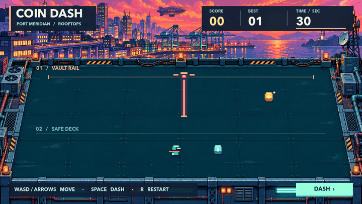

# Coin Dash

A 30-second rooftop score attack written in **ActionScript 3** for Godot 4.7. Run the lower deck for silver (+1), or cut across the drone’s patrol for gold (+3). A laser hit sends you back to the dock and costs three seconds. A well-timed dash takes you through the beam. The game saves your highest completed score on this device.



## Play

| Action | Keyboard | Controller | Touch or mouse |
|---|---|---|---|
| Start or play again | Space or Enter | Bottom face button | Press the menu button |
| Steer | WASD or arrows | Left stick | Hold or drag on the deck |
| Dash | Space | Bottom face button | Press **Dash** |
| Restart immediately | R | Top face button | |

Open this folder as a Godot project and press **Play** once the ActionScript 3 extension is built. From a source checkout, build it once using a [godot-cpp](https://github.com/godotengine/godot-cpp) checkout for Godot 4.7. Run these commands from the repository root, replacing the path on the first line.

```sh
cmake -S compiler -B compiler/build-godot -DKAS3_GODOT_CPP=/path/to/godot-cpp
cmake --build compiler/build-godot --target kas3_godot
godot --headless --editor --quit-after 300 --path examples/coin-dash
godot --path examples/coin-dash
```

## Inside the game

[Rooftop.as](Rooftop.as) connects Godot’s pickup signals, moves the courier and sweeps the laser across the gold route. Its typed waypoint vectors define repeatable routes you can learn across runs. [Round.as](Round.as) owns the clock, dash recharge and scoring. [Ledger.as](Ledger.as) reads and writes the local record through Godot’s ConfigFile API.

[Player.as](Player.as), [Coin.as](Coin.as) and [Scanner.as](Scanner.as) draw the animated actors directly in ActionScript 3. To try hot reload, change the courier’s scarf shape in the player's `_draw` method and save during a run. The score and clock carry on as you edit. [How hot reload works](../../docs/hot-reload.md)

## Run the gameplay tests

```sh
python3 testing/runner.py examples/coin-dash/kas3-tests.json --compiler compiler/build/kas3c --require-pass
```

The ActionScript 3 tests cover the buzzer, restart, dash immunity, hit penalty and silver and gold pickups through Godot physics. The [Claude Code plugin](../../editors/claude/README.md) also packages this project as its standalone starter.
