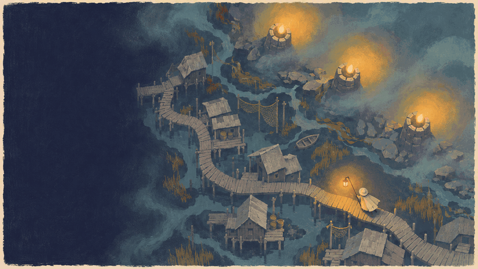

# Lantern Reach

Wren arrives at an empty lighthouse station on the last supply boat. Keep at least one of the town’s three beacons burning through five nights. The watches take 32 minutes in total, plus the time you spend ashore. On the fifth night, the Undertow must also fall.



## Play

Use Godot 4.7 .NET, the .NET 10 SDK and the Kumikae extension built against a matching local checkout of godot-cpp. Run these commands from the repository root. Set `KAS3_GODOT_DOTNET` to the Godot .NET executable. The build uses the Godot NuGet packages already installed on the machine.

```sh
cmake -S compiler -B compiler/build-godot -DKAS3_GODOT_CPP=/path/to/godot-cpp
nice -n 19 cmake --build compiler/build-godot -j4
(cd examples/lantern-reach && dotnet build -m:4 -p:Optimize=true --source "${NUGET_PACKAGES:-$HOME/.nuget/packages}")
"$KAS3_GODOT_DOTNET" --headless --editor --path examples/lantern-reach --import
```

Open `examples/lantern-reach/project.godot` and press **Play**. The default language is AS3. Pass `-- --lang cs` to the game executable or set the project setting `lantern/language` to `cs` to play the C# version.

### At the station

Walk the shore for washed-up kelp. Open **Build**, select a structure and choose a tile. Leave a lane from the bay to each beacon. Upgrade a structure twice to reach its third tier. Select a branch for the second upgrade. Selling returns half the salvage invested.

| Structure | Use |
|---|---|
| Lamp | Reveal lurkers and slow creatures inside the light. Walls cast shadows. |
| Wall | Divert the tide into firing lanes. Brutes can break driftwood. |
| Harpoon tower | Cover a long approach with piercing shots. |
| Brazier | Ignite nearby creatures. Fire spreads on contact. |
| Bell tower | Slow a group with a pulse. |
| Salvage rig | Bring in salvage during the watch. |

Choose **Begin the watch** when the defenses are ready. Sweep the lantern pole toward approaching creatures. Collect the shards they leave behind and choose one of three upgrades when Wren levels up. Watch the oil in each beacon and the countdown to dawn.

The station saves at dawn. Choose **Resume at dawn** on the title screen to continue. Every survived night and every lost keeper adds a page to the register. Read it for construction patterns, tide notes, marked wrecks and signals to watch for. The register, best night and settings live in `user://lantern-register.json`.

### Controls

| Action | Keyboard and mouse | Controller | Touch |
|---|---|---|---|
| Move | WASD or arrows | Left stick | Drag on the shore, or on the left half during a watch |
| Aim and swing | Aim with the pointer, hold the left button | Aim with the right stick or use the right shoulder | Touch the water to aim and swing |
| Dash | Space | Right face button | **Dash** |
| Place, upgrade or sell | Click a tile, or press E at Wren’s feet | Bottom face button at Wren’s feet | Tap a tile |
| Pause | Escape | Start | **Pause** |

Open **Settings** from the title or pause menu to adjust volume, screen shake and high-contrast fog.

## Inside the game

The [AS3 source](src/dev/kumikae/lanternreach) and [C# source](csharp) share the project, scene layout, [definitions](data), art and audio. The simulation uses a 60 Hz accumulator, double-precision coordinates and an integer xorshift generator. Input queues tick-stamped commands. Each tick runs input, spawn, flow, AI, movement, spatial indexing, collision, combat, status effects, pickups, light, economy and event delivery in that order.

The flow field routes around walls and weights marsh tiles. The spatial grid supplies neighbours for flocking, hits and targeting. Each species has a state object. The Undertow telegraphs chain sweeps, floods and summons as its health falls. The keeper’s log, HUD, audio and run statistics subscribe to simulation events.

The presentation batches each species in a `MultiMeshInstance2D`, reuses nodes for damage and effects, and uploads the light grid as a texture. The fog shader thins in lit areas. The music uses a copy of the run’s seed to time bell notes against the drone and crowd pulse. The [art manifest](assets/art/prompts.json) records the source prompts and sheet layouts. The [asset tools](tools) pack the art and synthesize the WAVs.

## Tests and benchmark

Set `KAS3_GODOT_DOTNET` as above. Run the system cases, scene and menu checks, and recorded first night from the repository root.

```sh
nice -n 19 python3 compiler/tests/run_lantern_reach.py compiler/build-godot/kas3c
```

Run the four benchmark scenarios over seven alternating rounds.

```sh
nice -n 19 python3 compiler/tests/bench/run_game_bench.py compiler/build-godot --runs 7
```

The harness stages a temporary project, imports its assets and builds optimized C# and native AS3. It runs the interpreter, native AS3 and C# with full headless presentation. Each row gives median milliseconds and the minimum and maximum. The totals exclude startup, compilation and checkpoint hashing. C# also reports managed bytes allocated on the game thread.

| Scenario | Recorded workload |
|---|---|
| `calm` | 150 swarmers and ten walls |
| `siege` | 2,000 creatures attacking 60 structures, with walls breaking |
| `flood` | 10,000 creatures, splitter broods and a wounded Undertow flooding the grid |
| `menus` | Dawn saves and restores, paged log entries, upgrade stamps and repeated HUD text changes |

Use `--scenario siege --runs 1` for a single comparison. The harness checks the entire sequence of 64-bit FNV-1a checksums, taken every 60 ticks and at the end. A missing checkpoint, runtime warning or disagreement fails the run.
